<p align="center">
  
</p>

<h1 align="center">ConfereAí</h1>
<p align="center"><b>Confira antes de pagar.</b><br>
Aplicativo Android (Kotlin + Jetpack Compose) que ajuda pessoas idosas a identificarem golpes financeiros antes de fazer um pagamento.</p>

---

## 👥 Equipe

| RM | Nome completo |
|----|---------------|
| RM558820 | Geisa Rodrigues Santos |
| RM558937 | Matheus Soares Pereira |

**Disciplina:** Android Kotlin Developer – Global Solution 2026/2 (Desafio CitizenTech)

🎥 **Vídeo pitch:** [link do vídeo](https://youtube.com/@matheussoaresae?si=N6MIN04S4kC6zixI)

---

## 🌎 Desafio CitizenTech

### Problema

A população idosa está cada vez mais conectada e virou o alvo preferido dos golpistas:

- **82%** dos idosos do estado de São Paulo já sofreram tentativas de golpes virtuais (Fundação Seade, pesquisa SP TIC 2025).
- Pessoas com mais de 60 anos têm a **maior proporção de vítimas em fraudes graves**, como empréstimos e contas abertas sem autorização.
- Os golpistas se passam por **bancos, lojas e até parentes**, usam a **pressa** e o **medo** e pedem pagamentos por **boleto ou Pix**.

### Público beneficiado

**Pessoas idosas (60+)** que usam o celular para pagar contas e receber mensagens, e as **famílias** que querem protegê-las.

### Proposta

O **ConfereAí** cria o hábito de **conferir antes de agir**. Antes de pagar um boleto ou Pix, o cidadão:

1. **Registra quem está cobrando** (nome, CNPJ opcional, forma de pagamento e valor).
2. **Confere o CNPJ na Receita Federal** (via BrasilAPI): se a empresa existe, se está ativa, há quanto tempo foi aberta e se o nome bate com o que disseram.
3. **Faz o teste do golpe**: 8 perguntas de "Sim" ou "Não" (pediram senha? código do SMS? disseram que é urgente? parente com número novo?).
4. **Vê o resultado em um semáforo** 🟢🟡🔴, com a explicação de cada sinal de alerta em linguagem simples.
5. **Liga para uma pessoa de confiança** com um toque antes de tomar qualquer decisão.

Todas as consultas e contatos ficam **salvos no aparelho (Room)** e continuam disponíveis depois de fechar o app.

### ODS relacionados

| ODS | Como o ConfereAí contribui |
|-----|----------------------------|
| **ODS 10 – Redução das desigualdades** | Promove a inclusão digital **segura** da pessoa idosa, que ganha autonomia para usar serviços digitais sem depender de terceiros (meta 10.2: inclusão social e econômica de todos, independentemente da idade). |
| **ODS 11 – Cidades e comunidades sustentáveis** | Fortalece a rede de proteção comunitária (família e pessoas de confiança) contra crimes digitais. |
| **ODS 3 – Saúde e bem-estar** | Reduz a ansiedade e o medo de usar o celular e evita perdas financeiras que afetam a saúde emocional. |

### Acessibilidade pensada para idosos

- Letras maiores que o padrão do Material 3, botões altos (mínimo de 56–60 dp) e alto contraste.
- Textos curtos, sem termos técnicos, e respostas por cores (semáforo) **e** por texto/ícone.
- Uma ação principal por tela, confirmação antes de apagar e mensagens claras após cada ação.

---

## ✅ Funcionalidades

| Funcionalidade | Descrição |
|---|---|
| **Tela inicial** | Logo, objetivo do app, menu com cartões grandes e botão "Ligar para minha pessoa de confiança". |
| **Sobre** | Problema, público, proposta, ODS, aviso de protótipo acadêmico e equipe. |
| **Cadastrar consulta** | Formulário com nome de quem cobra (**obrigatório**), CNPJ (opcional, **validado** com dígitos verificadores, inclusive o novo CNPJ alfanumérico), forma de pagamento (**obrigatória**), valor (validado) e teste do golpe. |
| **Consulta de CNPJ** | BrasilAPI (Retrofit) com os estados *carregando*, *sucesso* e *erro* (com "Tentar novamente"). |
| **Resultado (detalhe)** | Semáforo de risco, motivos, dados da cobrança, ligar para contato, marcar como confiável e apagar. |
| **Minhas consultas** | `LazyColumn` com filtros (Todas, Perigo, Atenção, Seguras, Confiáveis), ⭐ confiável e apagar com **Desfazer**. |
| **Pessoas de confiança** | Cadastro validado (nome + telefone com DDD), definir contato principal, ligar e remover. |

**Ações adicionais sobre os registros:** marcar/desmarcar como **confiável** (favorito) ⭐, **excluir** (com confirmação e "Desfazer") e, nos contatos, **definir como principal**.

**Regra de segurança:** cobranças com risco **alto** não podem ser marcadas como confiáveis.

---

## 📱 Fluxo de telas

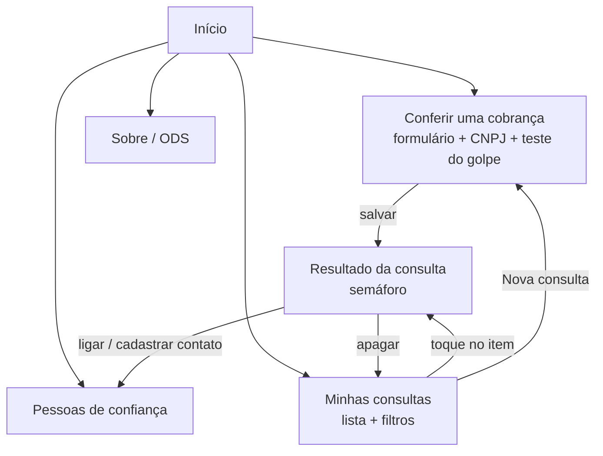

**Fluxo principal:** Início → *Conferir uma cobrança* → preencher quem está cobrando, (opcional) consultar o CNPJ, escolher Pix/Boleto, responder o teste do golpe → *Ver resultado e salvar* → tela de **Resultado** com o semáforo → voltar → *Minhas consultas* mostra o registro salvo, que pode ser marcado como confiável ou apagado.

---

## 🖼️ Capturas de tela


| Início | Sobre / ODS | Formulário | Validação |
|---|---|---|---|
| 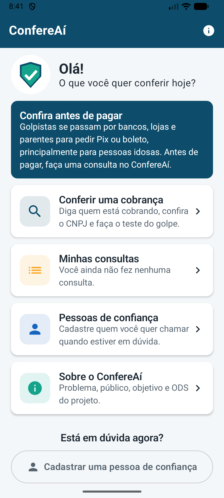 | 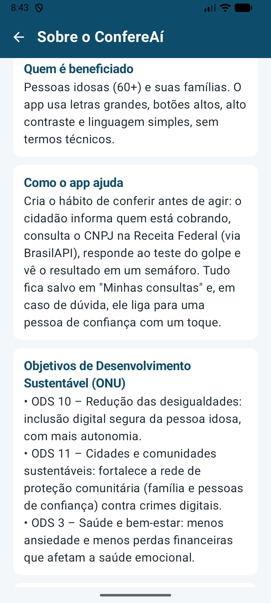 | 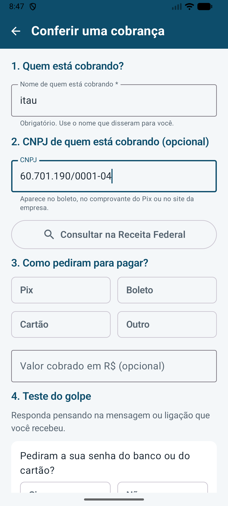 | 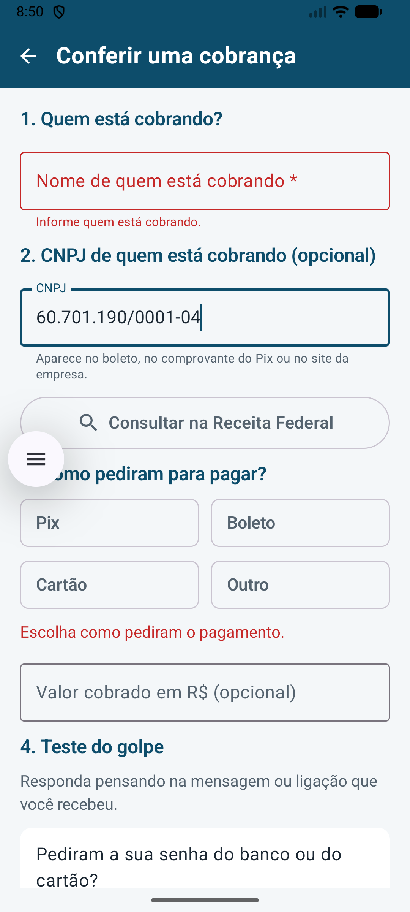 |

| CNPJ consultado | Resultado (semáforo) | Minhas consultas | Lista vazia |
|---|---|---|---|
| 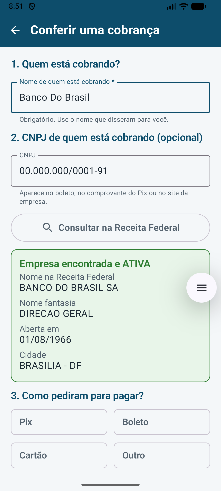 | 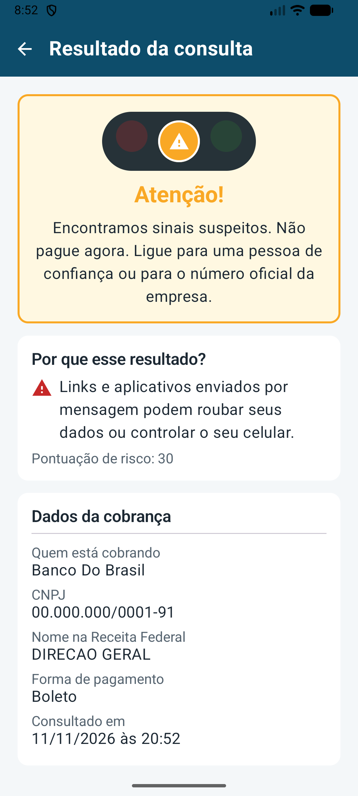 | 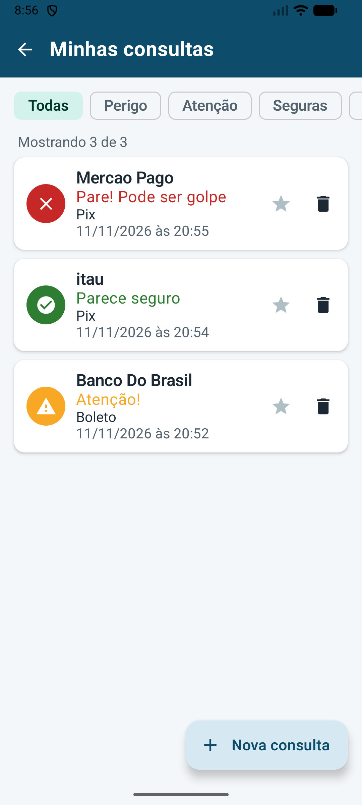 | 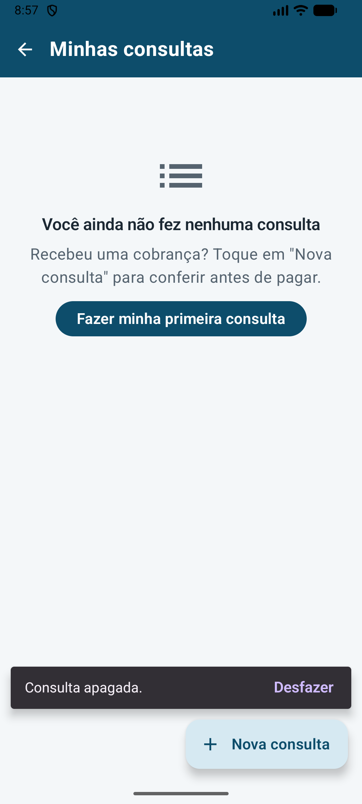 |

| Pessoas de confiança |
|---|
| 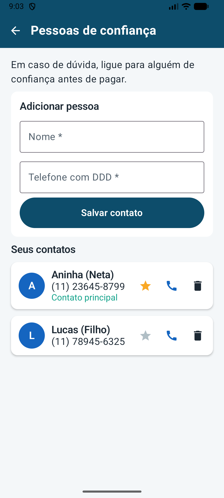 |

### Evidências exigidas

| Evidência | Print |
|---|---|
| **1. Criação de um registro** (consulta salva + mensagem "Consulta salva") | 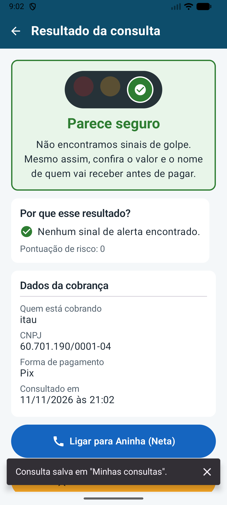 |
| **2. Ação adicional** (consulta marcada como confiável ⭐ / filtro "Confiáveis") | 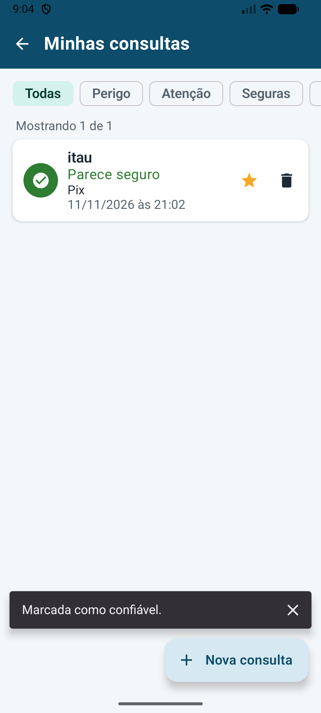 |
| **3. Permanência após reabrir** (app fechado pelo multitarefa e aberto de novo: a lista continua igual) |  | 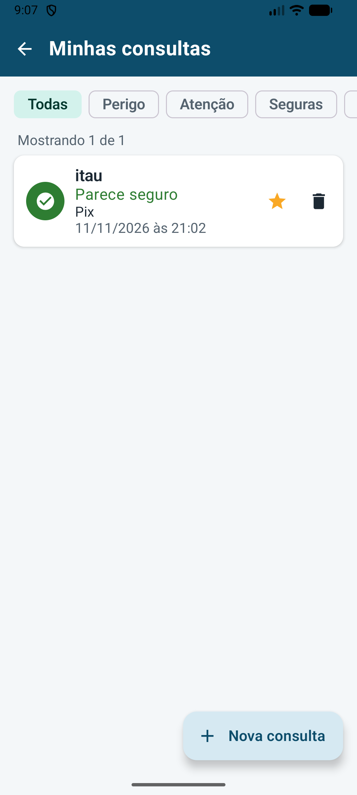 |

---

## 🛠️ Tecnologias

| Tecnologia | Uso |
|---|---|
| **Kotlin** | Linguagem do projeto |
| **Jetpack Compose + Material 3** | `Scaffold`, `TopAppBar`, `Column`, `Row`, `Card`, `LazyColumn`, `OutlinedTextField`, `Button`, `FilterChip`, `AlertDialog`, `Snackbar` |
| **Navigation Compose** | 6 rotas, passagem de parâmetro (`consulta/{consultaId}`) e `popUpTo` |
| **ViewModel + StateFlow** | `ConsultaViewModel` e `ContatoViewModel` mantêm o estado; a interface observa com `collectAsStateWithLifecycle` |
| **Room (KSP)** | Banco `confereai.db` com as tabelas `consultas` e `contatos`; DAOs retornam `Flow` |
| **Retrofit + Gson** (opcional) | Consulta de CNPJ na [BrasilAPI](https://brasilapi.com.br) |
| **JUnit** | Testes unitários das regras e teste instrumentado dos DAOs |

---

## 🏗️ Arquitetura (MVVM)

```
app/src/main/java/thisgeh/com/github/confereai/
├── MainActivity.kt               # cria os ViewModels e chama AppNavigation
├── data/
│   ├── local/                    # Room
│   │   ├── Consulta.kt           # @Entity "consultas"
│   │   ├── ConsultaDao.kt        # listar (Flow), buscarPorId, inserir, atualizar, deletar
│   │   ├── Contato.kt            # @Entity "contatos"
│   │   ├── ContatoDao.kt
│   │   └── ConfereAiDatabase.kt  # @Database (singleton)
│   └── remote/                   # Retrofit (BrasilAPI)
│       ├── BrasilApiService.kt
│       ├── BrasilApiServiceFactory.kt
│       └── EmpresaResponse.kt    # JSON -> modelo Empresa
├── model/                        # NivelRisco, FormaPagamento, PerguntaGolpe, Empresa, Avaliacao
├── regras/                       # Regras de negócio puras (testadas)
│   ├── ValidadorCnpj.kt          # dígitos verificadores (numérico e alfanumérico)
│   ├── ValidadorFormulario.kt    # campos obrigatórios, valor e telefone
│   ├── TextoUtil.kt              # compara nomes sem acento
│   ├── AvaliadorRisco.kt         # soma os sinais e classifica no semáforo
│   └── regrasrisco/              # Strategy Pattern (uma classe por sinal de golpe)
├── repository/                   # ConsultaRepository, ContatoRepository
├── viewmodel/                    # ConsultaViewModel, ContatoViewModel, Mensagem
├── navigation/                   # Rotas + AppNavigation (NavHost)
├── ui/
│   ├── components/               # BarraSuperior, CardOpcao, SemaforoRisco, EstadoVazio...
│   ├── screens/                  # Home, Sobre, NovaConsulta, Historico, DetalheConsulta, Contatos
│   └── theme/                    # cores, tipografia (letras maiores) e tema
└── util/                         # formatadores e discador
```

### Modelo de dados (Room)

**Consulta** (`consultas`): `id` (PK), `nomeCobrador`, `cnpj`, `nomeOficial`, `valor`, `formaPagamento`, `nivelRisco`, `pontuacao`, `motivos`, `confiavel`, `dataCriacao`.

**Contato** (`contatos`): `id` (PK), `nome`, `telefone`, `principal`.

### Regras de risco (Strategy)

| Regra | Pontos |
|---|---|
| Empresa não está ATIVA na Receita | +100 |
| Empresa aberta há menos de 6 meses / 1 ano | +40 / +20 |
| Nome informado não bate com o CNPJ | +35 |
| Cada "Sim" no teste do golpe | +25 a +60 |

Classificação: **0–29 🟢 Parece seguro**, **30–59 🟡 Atenção**, **60+ 🔴 Pare! Pode ser golpe**.

### Requisitos do enunciado × implementação

| Requisito | Onde está |
|---|---|
| 1. Contextualização e tela inicial | `HomeScreen.kt`, `SobreScreen.kt`, seção ODS deste README |
| 2. Navegação (≥ 3 telas) | `navigation/AppNavigation.kt` – 6 telas, parâmetro `consultaId`, voltar com `popBackStack` |
| 3. Interface Material 3 e estados vazios | `ui/screens/*`, `EstadoVazio.kt`, Snackbars de confirmação |
| 4. Entidade, cadastro, ação adicional, validação | `Consulta.kt`, `NovaConsultaScreen.kt`, `ValidadorFormulario.kt`, ⭐ confiável / excluir |
| 5. Persistência com Room | `data/local/*`, `ConsultaDaoTest.kt` |
| 6. Organização e ViewModel | MVVM em pacotes; `StateFlow` + `collectAsStateWithLifecycle` |
| 7. Documentação | Este README + `docs/prints/` |

---

## ▶️ Como executar

1. Abra a pasta do projeto no **Android Studio** (versão recente, com suporte ao AGP 9.2).
2. Aguarde o *Gradle Sync*. Se o Android Studio pedir, instale o **Android SDK Platform 37** (o projeto usa `compileSdk = 37`, igual ao projeto *to-do-list* da aula).
3. Escolha um emulador ou aparelho com **Android 7.0 (API 24) ou superior**.
4. Clique em **Run ▶**.

> A consulta de CNPJ precisa de internet. Todo o resto (cadastro, lista, semáforo, contatos) funciona sem internet.

### CNPJs para testar

| CNPJ | Resultado esperado |
|---|---|
| `00.000.000/0001-91` + nome "Banco do Brasil" | Empresa ativa e antiga 🟢 |
| `19.131.243/0001-97` + nome "Open Knowledge" | Empresa ativa 🟢 |
| `00.000.000/0001-91` + nome "Nubank" | Nome não bate 🟡 |
| Qualquer cobrança + "Sim" em "Pediram a sua senha?" | 🔴 |
| `12.345.678/0001-00` | CNPJ inválido (validação do formulário) |

### Testes

```bash
./gradlew test                   # regras de negócio (JUnit)
./gradlew connectedAndroidTest   # DAOs do Room (precisa de emulador)
```

---


## 📚 Fontes do problema

- Fundação Seade, *SP TIC*, 2025: [Golpes virtuais atingem 82% dos idosos em São Paulo](https://abcdoabc.com.br/golpes-virtuais-82-dos-idosos-em-sao-paulo/)
- [Oito a cada 10 idosos sofreram tentativas de golpes virtuais em SP (Viva)](https://viva.com.br/tecnologia/oito-a-cada-10-idosos-sofreram-tentativas-de-golpes-virtuais-em-sp.html)
- [ONU Brasil – Objetivos de Desenvolvimento Sustentável](https://brasil.un.org/pt-br/sdgs)